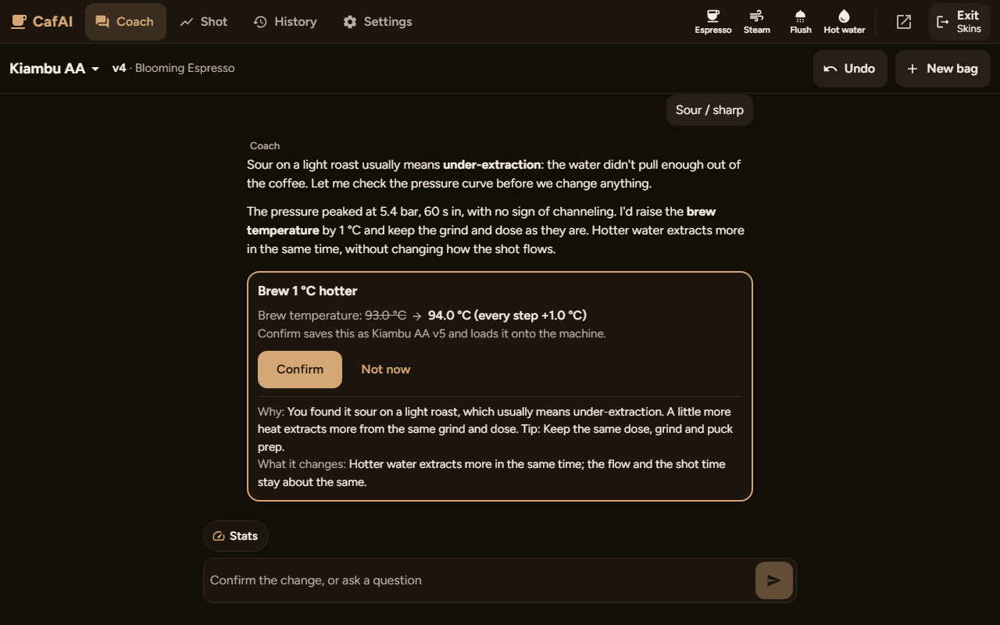
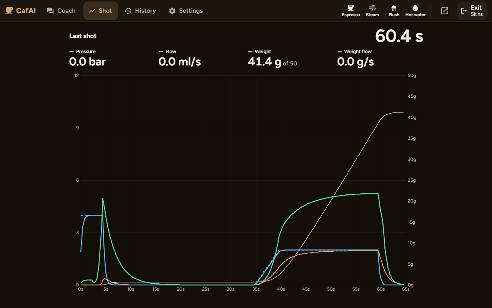
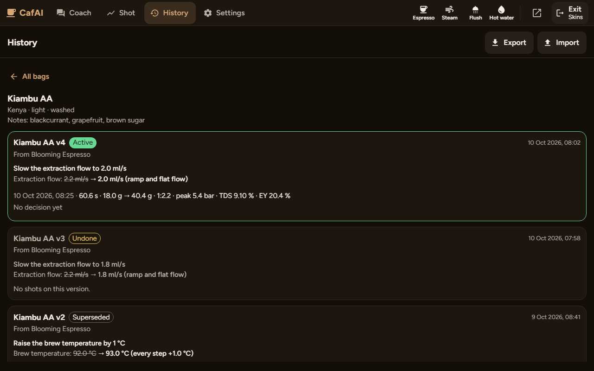
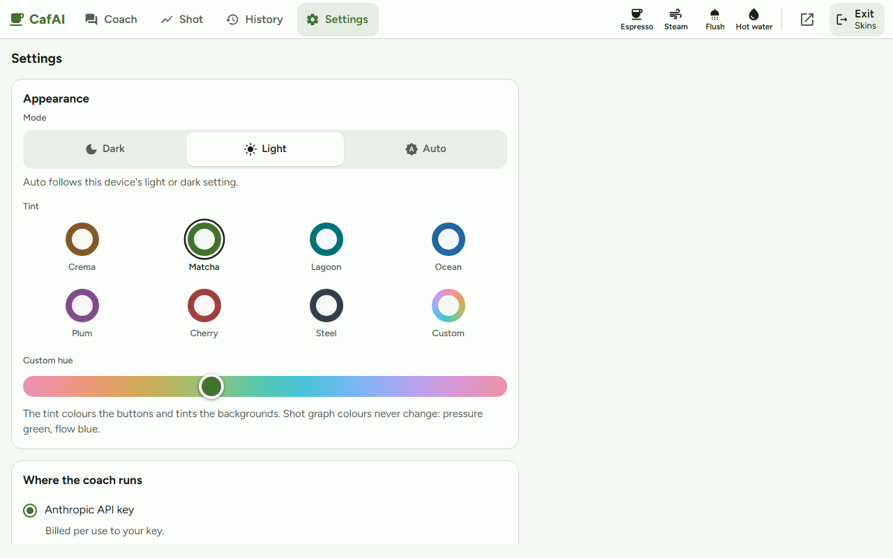
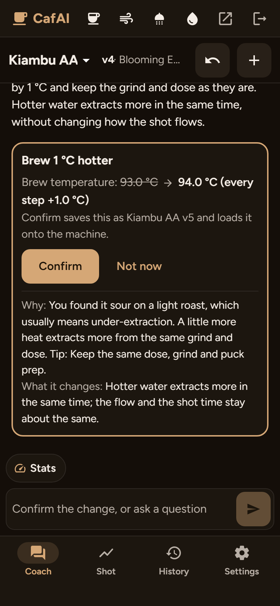
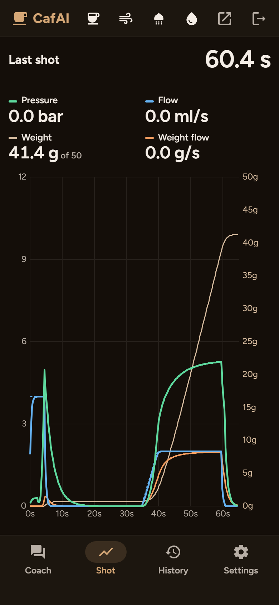
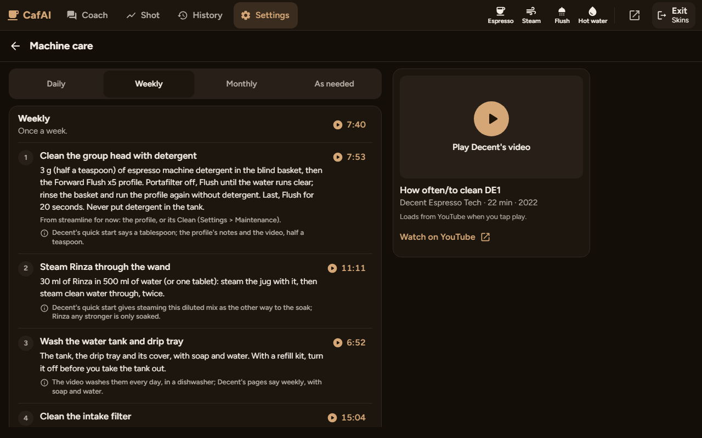
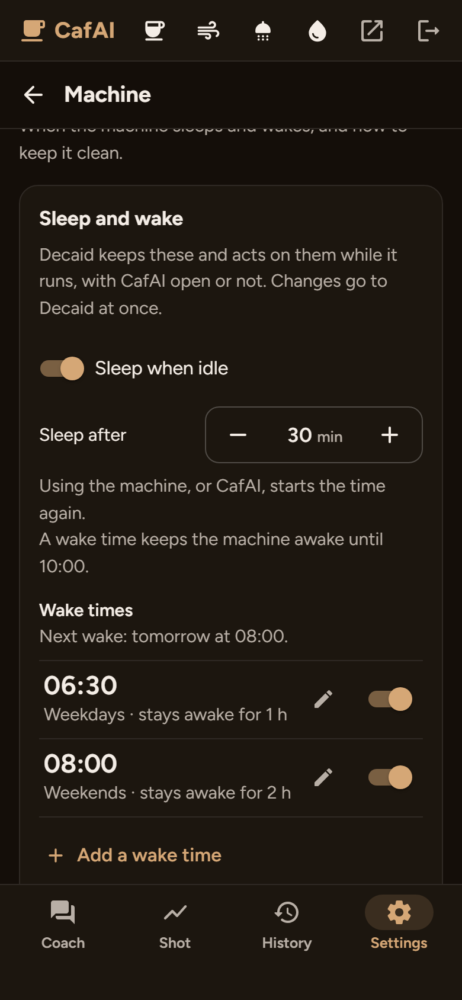

# CafAI

[](https://github.com/justinmwarner/CafAI/actions/workflows/ci.yml)

A chat-first AI dial-in coach skin for [Decaid](https://github.com/decentespresso/decaid),
the app for Decent Espresso machines. Tell it about the bag, pick one of the
suggested starting profiles, pull a shot, tap how it tasted, and confirm one
change at a time. Every version of your profile for that bag is kept, with
the shot data, your feedback and the change that led to it.

CafAI is also a complete everyday skin: espresso, steam, flush and hot water
from the top bar, a live card with the machine's state, a big live shot
graph, a live view of each steam, hot water and flush while it runs, a
tablet and a phone layout, and a look of your own. It follows the
patterns of Decent's own skin, streamline.js, and began as a port of Crema's
logic; see [Influences and thanks](#influences-and-thanks).



- Skin id: `cafai` (never changes; it fixes the skin's install folder, port
  and origin in Decaid, and so its saved data)
- Runs in Decaid's WebView, down to the Chromium 91 engine of older Decent
  tablets, at 962x602 CSS px and up (an older engine gets a warning; if CafAI
  cannot start at all, on any engine, a page offers Exit to Decaid and
  Decaid settings), and in a phone's browser on the same network (the phone
  layout)
- Bring your own Anthropic API key; it stays on the device you enter it on,
  unless you choose to keep a copy in Decaid (see [Privacy](#privacy)). Or
  let the coach answer through your own Claude Pro or Max plan, with CafAI
  Bridge on your Mac or Windows PC: no API key, nothing billed per call (see
  [Claude on your computer](#claude-on-your-computer-no-api-key))

**Status.** CafAI 0.1.1 is new. It is checked against Decaid's own API specs
and has passed every check against Decaid 0.8.8 running its simulated
machine and scale (2026-10-10), but it has not yet been used on a real
Decent machine: [docs/HARDWARE_TEST_PLAN.md](docs/HARDWARE_TEST_PLAN.md) is
the plan for that first session. Keep an eye on the machine when you try
it, and please [report](https://github.com/justinmwarner/CafAI/issues) what
you see.

## Contents

- [Screenshots](#screenshots)
- [What you need](#what-you-need)
- [Install](#install)
- [First run](#first-run)
- [How the coach works](#how-the-coach-works)
- [Screens and looks](#screens-and-looks)
- [On a phone](#on-a-phone)
- [Claude on your computer (no API key)](#claude-on-your-computer-no-api-key)
- [Privacy](#privacy)
- [Troubleshooting](#troubleshooting)
- [Develop](#develop)
- [Project layout](#project-layout)
- [Decisions and docs](#decisions-and-docs)
- [Influences and thanks](#influences-and-thanks)
- [License](#license)

## Screenshots

From the built-in demo (`npm run demo`, no machine needed);
`npm run screenshots` takes them again.

| The big shot graph, from a shot's card | History: every version, its change and its shots |
|---|---|
|  |  |
| **Settings > Appearance: Light, in Matcha** | **On a phone: the coach and the shot** |
|  |   |
| **Settings > Machine care: Decent's cleaning routine, by how often** | **Settings > Sleep and wake: warm at 06:30 on weekdays** |
|  |  |

## What you need

- **A Decent espresso machine with Decaid.** Decaid is Decent's app for the
  machine; it runs on Decent's tablets (Android) and on macOS, Windows, Linux
  and the iPad. CafAI is checked against **Decaid v0.8.8**, the pin in
  [`contract/decaid/PIN.json`](contract/decaid/PIN.json): use 0.8.8 or newer.
  On an older Decaid, CafAI handles the differences it knows (0.8.6's 0-100
  ratings, a Decaid that cannot confirm a profile load) and Settings > About
  says yours is older; a newer Decaid is checked every day by the drift
  watch ([Develop](#develop)).
- **A scale Decaid connects to** (recommended): Decaid stops a shot at its
  target weight only with a scale.
- **For the coach, one of:**
  - an **Anthropic API key**, from Anthropic's Console. You pay Anthropic
    directly for what the coach uses; **Settings > Coach** shows each
    model's price.
  - **Claude on your computer**: Claude Code signed in with a Claude Pro or
    Max plan on a Mac or Windows PC (Linux works too), Node 18 or newer, and
    this repository on that computer. See
    [Claude on your computer](#claude-on-your-computer-no-api-key).
- **Your grinder in Decaid's grinder library** (optional; CafAI can add it
  there): grind moves then come with the new setting worked out on its own
  steps.

## Install

**From a GitHub release:**

1. On the tablet, open Decaid's dashboard -> **Skins** (Decaid's docs call
   it **Launcher -> Skins**), tap **+** (Install skin) and choose **GitHub
   Release**.
2. Enter `justinmwarner/CafAI`. Decaid takes the latest release's `.zip`
   asset, installs it and lists **CafAI**, and checks for a newer release
   every 12 hours.
3. Select **CafAI** as the skin.

**Check for updates** on the same page fetches a newer release from the same
place.

**From a zip you built yourself** (or when there is no release yet): on a
computer, `npm ci` and `npm run release:zip` write
`release/cafai-<version>.zip`. Copy it to the tablet and use **Skins -> + ->
ZIP file**, or serve it over HTTP from the computer and tell Decaid to fetch
it:

```bash
curl -X POST http://<tablet-ip>:8080/api/v1/webui/skins/install/url \
  -H "Content-Type: application/json" \
  -d '{"url": "http://<your-computer>:<port>/cafai-<version>.zip"}'
```

To leave CafAI, tap **Exit** (top right). Inside Decaid it returns to the
dashboard, where the Skins page switches skins; in a browser it opens Decaid's
settings page.

## First run

1. **The coach's key.** The chat opens on "Add your Anthropic API key to
   start coaching". Open **Settings** and paste the key under **Anthropic
   API key**, or choose **Claude on my computer** under **Where the coach
   runs** ([below](#claude-on-your-computer-no-api-key)). The machine row,
   the stats card and the shot graph work without a key.
2. **The machine and the scale.** Decaid connects them, as for any skin. The
   stats card in the chat shows **DE1** and **Scale** with a green dot when
   they are connected. When one is missing, the slim alert under the top bar
   offers **Connect DE1** or **Connect scale** (details in
   [Screens and looks](#screens-and-looks)).
3. **Gateway mode.** When Decaid is set to leave stopping shots to the skin
   (gateway mode Full), the alert says so, and **Let Decaid stop shots** sets
   it to Tracking. CafAI never changes Decaid's settings without that tap.
4. **Your grinder** (optional): link it in **Settings > Coach**, from
   Decaid's grinder library, or add it there with **Add a grinder** when
   the library does not have it.
5. **A bag.** On the coach, "Which coffee is it?" lists the coffees in
   Decaid's bean library. Pick one, photograph the bag, or describe it; pick
   one of the starting profiles; pull a shot.
6. **Usage sharing** (CafAI's releases). From the first start, a card on the
   coach screen asks "Help improve CafAI?" where the device's time zone or
   language points to Europe, or its time zone says nothing: **Yes, share**
   or **No thanks**, and nothing goes to Microsoft Clarity before Yes.
   Elsewhere a notice in its place says CafAI shares how it is used, with
   all text hidden: **OK** or **Turn off**. It sits under the screen's first
   card until there is a chat, then at the chat's foot, above the composer;
   it stays until you answer and holds nothing up. **Settings > About**
   changes the answer later ([Privacy](#privacy)).

To see it first without a machine, run `npm run demo` on a computer: CafAI
with a dial-in already under way, on the built-in mocks, with no Decaid and
no API key ([docs/DEMO.md](docs/DEMO.md)).

## How the coach works

1. **New bag.** The chat opens on "Which coffee is it?": the coffees in
   Decaid's bean library, newest roast first, then **Photo of the bag** and
   **Something else**. Pick one and CafAI fills in the bag (name, roaster,
   origin, process, notes, roast level and roast date) and links it to that
   batch. Take a photo and the coach's model reads the label into a card
   you correct and confirm. Or tap Something else, or just type, and
   describe the coffee: origin, roast, process, tasting notes, the roast
   date if the bag has one. A bag the coach saved or a photo you confirmed
   is added to Decaid's bean library once it has a name and a roaster
   (reusing a bean with the same roaster and name, and its unarchived batch
   with the same roast date), and every load names the bag's batch, name
   and roaster in Decaid, so its shots carry them.
   The coach knows how old the coffee is; for a coffee picked from the
   library, days its batch spent in a freezer do not count. When Decaid's
   DYE2 plugin recorded setups for this coffee, or an earlier roast of it,
   the coach can read them (it never changes them) and start from what you
   did before.
2. **Templates.** The coach suggests 2-5 starting profiles with a rough
   confidence. Templates are real Decent profiles (Blooming Espresso,
   D-Flow, Londonium, Rao Allongé, Gentle and Sweet) that declare which
   fields may change and how far.
3. **v1.** Tap one: CafAI creates "<Bean> v1" and loads it on the machine.
   v1 stops at the profile author's ratio times the dose set in Decaid (18 g
   when Decaid has none, or one outside 12-25 g), rounded to the gram and
   kept within the template's yield range, and the chat says so. CafAI says
   "Loaded" only once Decaid confirms the machine holds the profile (an
   older Decaid that cannot confirm it gets a one-time note that CafAI
   assumes it did).
4. **Shot.** Pull a shot. CafAI reads the shot from Decaid, summarizes it
   (aggregates plus a 1-per-second series) and gives the coach named query
   tools to look closer (no code execution).
5. **Feedback.** Tap how it tasted (the last option is always "Other"), or
   say it in your own words. The coach never tells you what a shot should
   taste like; while it asks how the shot tasted, **Taste words** above the
   composer offers neutral words for the acidity, sweetness, bitterness,
   body and finish (a tap puts one in your message, a second takes it out;
   nothing is sent until you send), and **Need help?** explains how to
   taste. If you like, also say how the shot compared with your previous
   one: Much worse, Worse, About the same, Better or Much better (a bag's
   first shot is compared with your last shot of another coffee). The card
   draws that shot faintly under its own pressure and flow, a pale band in
   the same colours, so the change the coach made shows on the curve. The
   coach hears your words, and both go to the shot's record in Decaid, so
   they show there and in Visualizer; the comparison becomes a running
   score in `enjoyment`, on the rating scale your Decaid keeps (0-10, or
   0-100 on older builds): CafAI asks it. When Decaid's Visualizer plugin
   has uploaded the shot, its card links to the shot's page (**On
   Visualizer**), and History keeps the link. With a refractometer, tap
   **TDS · Add** among the card's numbers and type its reading (0.01-25 %;
   a comma works too): CafAI works out the extraction yield (EY) from the
   card's own dose and yield, so the EY is the TDS times the ratio, shows
   both on the card and in History, and writes them to the shot's record in
   Decaid (`drinkTds`, `drinkEy`), which Visualizer reads. The coach hears
   the reading with your next tap or message, even one typed after it
   suggested a change, and is told it is a number about extraction, never a
   taste. A shot with no yield (no scale) keeps its TDS without an EY. A
   taste, rating, TDS or grinder setting Decaid did not take is tried again
   every 30 s until it goes through (a reload drops what waits); one Decaid
   refuses is dropped, and the chat says so once.
6. **One change.** The coach proposes the next version or a manual step such
   as grind, changing one variable at a time, and explains it by what it
   does at the machine, with your own words as the reason. With °F chosen
   in Settings > Appearance it speaks °F (1 °C hotter is 1.8 °F hotter),
   while the change itself goes to the machine in °C. You see a
   plain-language diff and confirm it before anything is uploaded. Undo
   returns to the previous version. Link your grinder from Decaid's grinder
   library in **Settings > Coach** (add it there if the library lacks it,
   or tap **Add to Decaid** on the coach's card when you name it in the
   chat) and grind moves come with the new setting worked out on its own
   steps.

7. **Fun facts.** Once you have kept a recipe, a shot that runs like the
   last one on it (pour time within 3 s, yield within 1.5 g, peak pressure
   within 1 bar, first drop within 3 s, no new channeling flag) gets one fun
   fact, in a quiet card of its own between the coach's line and the taste
   question. The coach shares one about the bag when it is sure of it (its
   roaster, region, process, variety, or where the notes on the bag come
   from); otherwise CafAI picks one from its own list of researched facts,
   each checked against the page it came from: the bag's first, then
   roasting, growing, fermenting, espresso science, history, milk and latte
   art, and cleaning. A fact never says what your cup tastes like, and
   names a flavour only when your bag's notes do. CafAI keeps the facts it
   told on the device so they do not come back soon; **Settings > Coach >
   Fun facts** chooses where they come from, or turns them off.

The model can only move declared template levers within their bounds; it can
never change pump type, step order or count, sensors, or exit types.

A shot counts only for the version the machine ran: a shot that ran another
profile (another skin's, or one picked on the machine) is left out of the
dial-in, and the chat says so. A run of a cleaning or calibration profile,
such as Forward Flush x5 for the weekly clean, is no shot at all: Decaid
keeps no record of it, and the chat says nothing. Nor is a shot stopped
before it poured, or in its first 2 s of pour (Espresso, then Stop at
once): no card and no taste question, the next shot is compared with the
last one that counted, and the chat says so in one line. While the page is
open, CafAI also looks at Decaid's loaded profile every 30 s and says so
when it is not the bag's, with **Retry**; it never loads anything on the
machine by itself.

## Screens and looks

- **Tablet** (800 x 500 CSS px and up, every Decent tablet): a top bar with
  Coach, Shot, History and Settings, the machine row (Espresso, Steam, Flush
  and Hot water; the one running turns into Stop in its place; Wake alone
  while the machine sleeps), Decaid settings and Exit, and the coach across
  the whole width under it. The chat opens with the live stats card (state,
  temperatures, water, scale with Tare, the loaded profile, Sleep, and a
  line when a step of machine care is due); it goes once the chat moves on,
  and **Stats** above the composer brings it back. Shot opens the graph. When a
  shot starts, the screen becomes the Shot view by itself: a big timer,
  pressure, flow, weight and weight flow, the graph, with the bag's previous
  shot faintly under it ("Previous shot · 28.1 s · 36.2 g" over the plot),
  and a note from the coach saying it is watching. When the shot's card
  reaches the chat, the coach comes back by itself (the graph then draws
  the shot the card asks about); the top bar and Stop never move. Steam, hot
  water and flush take the screen the same way while they run, whoever
  started them (unless you are typing, or following Decent's cleaning video
  in Settings > Machine care): a dial fills toward the time or volume set
  (steam rising from milk, water filling, the shower screen pouring, still
  under reduced motion), with the machine's readings (steam temperature,
  pressure and flow; hot water's flow, the scale and the time; the flush's
  water, flow and group temperature), a trace of the run, and the drink's
  own settings, held while it runs and yours to change the moment it stops.
  The view stays with its result; **Go back** returns to where you were. Problems
  (not connected, Decaid out of reach, water to refill, an error the machine
  or a device reports, a failed command, Decaid set to leave stopping shots
  to the skin, a scale that dropped) show in one slim alert under the top
  bar, with a button where one tap fixes them; a failed command or a device
  error stays until you close it.
- **Phone** (anything smaller): one screen at a time, with Coach, Shot,
  History and Settings tabs at the bottom (a rail at the side when the phone
  lies down) and the machine row as icons in the top bar. The chat has the
  same stats card and Stats prompt. A shot opens the Shot tab with the big
  graph; on the Coach tab a live strip shows the time, weight and pressure
  and opens it. See [On a phone](#on-a-phone).
- **Fixes in the alert.** When the machine is not connected, the alert has
  **Connect DE1** (and **Connect scale** when the scale is missing too);
  when only the scale dropped while the machine is awake, **Connect scale**.
  A Connect looks for devices without connecting them, then connects only
  the one Decaid itself would: its preferred one, or the only one in range
  when it has none. So the other device is never disturbed, and when the
  choice is Decaid's to make (its preferred one is away but another is
  there, it sees several, or it did not say which it uses), the alert says
  so and asks you to choose on Decaid's scan screen instead. When a scale
  that was connected earlier is missing, CafAI also looks for Decaid's
  preferred scale by itself after the machine wakes or the page comes back
  into view (at most every 30 s). When Decaid's gateway mode is Full,
  Decaid leaves stopping at the target weight to the skin, and CafAI does
  not stop shots, so they would run past it: the alert says so, and **Let
  Decaid stop shots** sets Decaid to Tracking. CafAI never changes Decaid's
  settings without that tap.
- **Heating.** While the machine warms up, the stats card says Heating, not
  Ready, and when Decaid's time-to-ready plugin is loaded it adds "Ready in
  about 3 min" (or "Ready in under a minute") at the end of that line.
- **Next step.** During a shot whose profile has another step, the Shot view
  has **Next step** under the graph: one tap moves the shot on one step.
- **Which coffee is it?** A new bag's chat opens on this card, shown from
  its top: up to 8 coffees from Decaid's bean library (newest roast first,
  each with its roaster, its roast date and **Use this**), then **Photo of
  the bag** and **Something else**. The card is there at once ("Looking in
  Decaid's beans…") and the coffees fill in; the photo and Something else
  work meanwhile, and without Decaid. Typing in the chat instead closes it.
  The photo opens the camera or the device's picker (what a Decent tablet
  offers depends on the Decaid version: docs/HARDWARE_TEST_PLAN.md section
  12), and what the coach's model reads on the label lands in **Check the
  bag's details**, every field editable, with **Confirm**.
- **On Visualizer.** With Decaid's Visualizer plugin loaded and set up, a
  shot's card links to the shot's page on visualizer.coffee once the plugin
  has uploaded it (CafAI looks for 30 s after the card lands), and
  History's shot rows keep the link. Decaid opens it in the system browser.
- **History**: every bag, its versions with the change that made each, and
  their shots; **Export** writes it all as JSON and **Import** merges a file
  back.
- **Settings > Appearance**: Dark, Light or Auto (follows the device), and a
  tint named for coffee: Crema, Matcha, Cold Brew, Blueberry, Plum, Cherry,
  Tamper, or any hue from the slider. Every colour comes from the tint (in
  OKLCH, written out as plain hex for Chromium 91) and every pair of
  palette colours the screens use is tested for WCAG AA contrast at every
  hue; the shot graph keeps Decent's colours (pressure green, flow blue).
  The look is saved with the other settings. Last, **Temperatures**: °C (the
  default) or °F. In °F every temperature CafAI shows or takes is in °F (the
  stats card, the drinks' views and settings, the change card and History,
  the cleaning guide), and the coach speaks °F; Decaid and your profiles
  keep °C. [DESIGN.md](DESIGN.md) describes the visual system.
- **Settings > Where the coach runs**: **Anthropic API key** (the default)
  or **Claude on my computer** (CafAI Bridge's address and code, with
  **Find** and **Test**). The fields follow the choice: the API key's
  section shows only with Anthropic, the bridge's address and code only
  with the computer; whatever you saved for the other one stays saved.
- **Settings > Anthropic API key** (with Anthropic chosen): the key, and
  **Keep my API key in Decaid** (off by default; see Privacy for what it
  means). A key pasted into the chat or another field is taken out, with a
  note.
- **Settings > Coach**: the model (Opus 5.5 by default, Opus 5, Sonnet 5,
  Haiku 4.5 or Fable 5.1, each with its price per million tokens), **Fun
  facts** (Off; CafAI's facts, from its own checked list, free; CafAI's and
  the coach's, the default, where the coach adds facts about the bag it is
  sure of; or CafAI's, the coach's and a web search, where the coach may
  look the roaster, farm or producer up on the web, once per fact, at about
  one US cent a search plus the pages it reads, or on your Claude plan
  through CafAI Bridge) and your grinder, from Decaid's grinder library. **Add a grinder** adds one the
  library lacks (its burrs and its dial: a numbered dial with its steps, or
  a list of settings, finest first) and picks it; **Edit grinders in
  DYE2**, while Decaid runs its DYE2 plugin, opens DYE2's Grinders page,
  where grinders are edited and deleted (Decaid's own app has no such
  screen).
- **Settings > Steam, hot water and flush**: the presets Decaid keeps for
  the machine row's Steam, Hot water and Flush, grouped by drink (steam
  temperature, time and flow; hot water temperature, volume, time and flow;
  flush temperature, time and flow): side by side on a tablet, one row per
  setting on a phone. Each has a stepper (Up and Down on a keyboard too),
  within what the DE1 can hold (hot water at most 255 ml; steam 135-160 °C,
  165 on a Bengle). In °F a temperature shows in whole degrees and a tap
  moves it one whole °C, the step Decaid keeps (2 °F, or 1 °F one time in
  five); one typed in °F is set to the nearest whole °C, and the field shows
  what Decaid keeps. A value goes to Decaid only when you change it, never
  while the machine runs, and never without a DE1 connected; until Decaid
  answers, the fields show a dash, and a write that fails says why under
  its setting. Steam that is off in Decaid (below 135 °C) reads "Off in
  Decaid"; turning it on or off stays in Decaid.
- **Settings > Sleep and wake**: what Decaid does with the machine when
  nobody is using it. **Sleep when idle**, with the minutes it waits (1 to
  240), and the **wake times**: each a time, its days (every day, weekdays,
  or any you pick) and how long the machine stays on after, even with
  nobody there (an hour for a new one, so a machine woken at 06:30 is not
  asleep again by the time you come down), with the next wake over the
  list. Decaid keeps them and acts on them while it runs, CafAI open or
  not, and only while the machine is connected; its own Sleep & Wake page
  shows the same. Changes go to Decaid at once.
- **Settings > Machine care**: **Cleaning guide** opens Decent's routine for
  the DE1, one at a time: **Daily** (purge the wand, flush the group head,
  wipe the shower screen, rinse the wand), **Weekly** (detergent, Rinza, the
  tank and drip tray, the intake filter), **Monthly** (the group head's
  parts, the gasket) and **As needed** (descaling for your water, a clogged
  steam tip, emptying the machine to move it). Each step says what to do and
  when, with its moment in Decent's video "How often/to clean DE1"; where
  the 2022 video and Decent's current pages differ, the step follows the
  pages and says so. The video plays in place in a browser and on Decent's
  tablets; inside Decaid on Windows, a Mac or an iPad, each moment opens
  YouTube at that time instead (Decaid would not let it play in place).
  While the video is open, a drink you start (the flush a step asks for,
  say) leaves the guide on screen rather than taking it over. The steps are
  CafAI's own words and work offline. CafAI does not start the DE1's
  Clean, Descale or Transport; the steps that need them say to use
  streamline, the skin Decaid comes with.
- **Machine care's reminders**: every step beyond Daily says when it was
  last done ("Last done 9 days ago · 41 shots since"), with **Mark done**
  (and **Undo** until the page reloads). Five come due by themselves and
  say **Due**: the weekly clean, a week after the last once a shot was
  pulled; Rinza, a week after once the wand steamed; the intake filter,
  every two weeks (V1) or month (V2); the group head's soak, every four
  weeks; and the descale by your water. The stats card then has one quiet
  line for the step most overdue, "Weekly clean due: 41 shots since the
  last", which opens it on the Care screen; never the alert under the top
  bar. The shots and steams are Decaid's own (any skin's count), counted
  from the first time CafAI looked, so a new install is never due at once.
  A Clean or Descale CafAI sees the machine run for a minute, started
  elsewhere while CafAI is open, marks its step done too; Decent's Forward
  Flush x5 does not, as it is the daily water flush's profile as well. Each
  device keeps its own last times, as it keeps its own bags: a step marked
  done on a phone is not marked on the tablet. In Settings > Machine care:
  **Your water**, in Decent's bands (under 30 ppm never descale; up to 120
  ppm once a year or 1,500 shots; over 120 ppm every six months or 800
  shots; Not sure is reminded as up to 120), **Intake filter** (V1, V2 or
  Not sure, reminded as V1) and **Remind me on the stats card**.
- **Settings > About**: CafAI's version, and the Decaid you run next to the
  one CafAI was checked against ("Decaid 0.9.0 (CafAI was verified with
  0.8.8)", with a note when yours is older); anything Decaid sent that
  CafAI did not expect, with **Copy report** (Decaid's routes and field
  names, with counts and both versions, never your notes or the key); and
  when CafAI last backed up to Decaid. In CafAI's releases, last, **Share
  usage with CafAI's developer** ("Screens, taps and coach steps go to
  Microsoft Clarity, with all text hidden."): on while this device shares;
  off stops it at once and on starts it again, and each device keeps its own
  answer ([Privacy](#privacy)).
- **Settings > Log**: what CafAI sends to and gets from Decaid (its REST
  calls and WebSocket frames) and the coach, as it went ("214 entries
  since 21:04, 1.2 MB"). **Open log** shows it full screen, newest first,
  one line per entry, with filters (All, Decaid, Live frames, Coach),
  **Pause**, and the raw headers and body of an entry you tap. **Share**
  (where the browser has a share sheet), **Email** and **Copy** send the
  whole log with CafAI's and Decaid's versions and your device; **Clear**
  empties it. The machine's and the scale's frames are kept once a second
  ("frame +4" counts the rest). The API key and the bridge's pairing code
  are never in it.

## On a phone

A phone on the same network opens CafAI at `http://<tablet-ip>:3000`
(Decaid's entry for the skin it serves, so CafAI must be the selected skin)
and gets the phone layout. Its browser storage is its own, so the API key is
entered again there, unless you keep a copy in Decaid; bags and the look
come back from Decaid's key-value store.

## Claude on your computer (no API key)

The coach can answer through your own Claude plan instead of an API key:
CafAI Bridge, a small program in [`bridge/`](bridge/README.md), runs on
your Mac or Windows PC and passes the coach's turns to the Claude Code
you have signed in there. Nothing is billed per call; the turns count
against your plan's usage limits.

You need Claude Code signed in with a Claude Pro or Max plan (install it
and run `claude` once, then `/login`; the copy the Claude desktop app keeps
works too) and Node 18 or newer.

1. On the computer, in CafAI's folder: `npm run bridge`. The first time it
   asks a few questions: is Claude Code there and signed in, does CafAI run
   on a tablet or on this computer, when should the bridge run (every
   morning on a schedule, 05:00-10:00 unless you say otherwise; always; or
   only when you start it), and, on Windows, may the firewall let the
   tablet in. Then it prints the address to use and a pairing code, for
   example `192.168.1.20` and `K7QM-2XWD`.
2. In CafAI, **Settings > Where the coach runs > Claude on my computer**:
   type the address (`127.0.0.1` when Decaid runs on that same computer) and
   the code, **Save**, then **Test**.
3. `npm run bridge -- setup` changes the answers later; `status` says
   whether it runs and when it starts next; `doctor` checks Claude Code, its
   sign-in and a real turn.

On a schedule the computer must be on (or asleep: the Windows task wakes
it, where wake timers are allowed), and on Windows you must be signed in (a
locked screen is fine); the bridge keeps the computer awake while it runs
(setup asks; yes by default) and stops itself at the end of the window. The
first time it listens, Windows Defender Firewall (or macOS's firewall) asks
whether Node.js may accept connections: allow it on private networks, or
the tablet cannot reach it (setup checks this on Windows). A VPN must allow
LAN connections. Claude Code must be new enough for the model picked in
Settings: **Test** says which version it needs, and `claude update` fixes
it. The bridge listens on port 8877; `npm run bridge -- code` shows the
code again and `code --new` makes a new one. The bridge is for your own use
with your own plan; [bridge/README.md](bridge/README.md) has the details and
troubleshooting.

## Privacy

- Your Anthropic API key is stored in this skin's local browser storage on
  the device you enter it on. It is never included in exports or in CafAI's
  backup in Decaid (namespace `cafai`), and never logged.
- **Keep my API key in Decaid** (Settings, under the key; off by default)
  also keeps a copy in Decaid's key-value store, in a namespace of its own
  (`cafai-key`), so the key survives a Decaid update or a cleared browser.
  What that means: any device on your network can read Decaid's store,
  Decaid's backups include it, and any browser that opens CafAI without a
  key of its own (a phone, say) takes the copy. Turning the switch off
  deletes the copy, and so does **Forget key** (a key you save later is
  copied again while the switch is on). If Decaid cannot be reached when you
  forget the key or save a new one, CafAI deletes the copy (or copies the new
  key) as soon as Decaid is back, and a forgotten key never comes back from a
  copy.
- Coach data (bags, versions, shot summaries without their curves,
  feedback, each bag's chat, machine care's last times and your settings)
  is stored in the skin's IndexedDB and copied to Decaid's key-value store
  (namespace `cafai`) so it survives a browser-storage reset. Like the key's
  copy, any device on your network can read it there. Export it any time as
  JSON from History.
- To count the shots and steams since a step of machine care, CafAI asks
  Decaid which shot and steam are its newest and when they began, and how
  many it holds; it keeps those, never the shots themselves.
- A photo of a bag goes to Anthropic once, in a request of its own, to read
  the bag's details. CafAI keeps no copy of the photo (not on the device,
  not in Decaid, not in the chat or an export), and with an API key the
  request is not marked for Anthropic's prompt cache. What the model read
  waits in a card in the chat; it becomes the bag's details only when you
  confirm it.
- When the coach saves a bag's details, or you confirm a photo's, CafAI
  adds the coffee to Decaid's bean library once it has a name and a roaster
  (a bean and a batch, or the ones already there; it never edits or deletes
  one); a coffee you pick from the library is linked as it is. Every
  profile load writes the bag's name, roaster and batch, the grinder and its
  setting, the dose and the target yield into Decaid's workflow, with a
  CafAI tag naming the bag and its version, so Decaid keeps them in each
  shot's record,
  which is what Visualizer gets if you upload there. v1 and every version
  you confirm are also added to Decaid's profile library.
- A grinder you add in Settings (**Add a grinder**), or on the coach's card
  after you name it in the chat, goes into Decaid's grinder library, where
  Decaid and your other skins list it. Nothing is added without your tap;
  CafAI takes a grinder already there with the same model rather than add
  it twice, and never edits or deletes one (DYE2's Grinders page does
  that).
- The coach may read the setups Decaid's DYE2 plugin recorded for the
  coffee (profile, grind, dose, yield, rpm, basket and date, and DYE2's
  equipment and basket names), which then go to Anthropic with the rest of
  the conversation. CafAI never writes DYE2's data.
- Your taste answer for a shot, how it compared with the shot before, and
  a TDS you type with its EY, are also written to that shot's record in
  Decaid (notes, a running score as enjoyment, `drinkTds` and `drinkEy`, and
  CafAI's own extras), which Decaid may upload to Visualizer if you set that
  up. Notes you wrote yourself are never overwritten.
- Settings > Machine care loads nothing from YouTube until you tap play or
  one of the video's moments. Then YouTube's player comes from
  `youtube-nocookie.com` (YouTube's privacy-enhanced mode), and YouTube,
  that is Google, sees your device's address and that the video played.
  Inside Decaid on Windows, a Mac or an iPad a moment opens YouTube in your
  browser instead.
- With an API key, calls go straight from the tablet to `api.anthropic.com`.
- With Claude on my computer, calls go from the tablet to CafAI Bridge on
  your computer, over your network in plain HTTP with the pairing code
  (kept on the device like the API key, never in Decaid or an export), and
  from there to Anthropic through your own Claude Code. The bridge keeps
  nothing you or the coach said: its log has times, message counts,
  durations, model names and its own events (the address of a device that
  sent a wrong code, Claude Code's version and error output), never the
  code. It never reads or stores your Claude credentials (it asks Claude
  Code only whether you are signed in, and with which plan), and coach
  turns run with Claude Code's settings and built-in tools off, in an empty
  folder, so your hooks, plugins and CLAUDE.md stay out of them. The one
  exception is Claude Code's WebSearch, on for coach turns while Fun facts
  includes a web search, and only then.
- With Fun facts on a web search, the coach's searches (the roaster, farm or
  producer of the bag you are dialing in) go to Anthropic's web search, or,
  through CafAI Bridge, to Claude Code's. The facts CafAI told stay in the
  device's own storage, never in Decaid's backup or an export.
- **Usage sharing** (CafAI's releases only). CafAI shares how it is used
  with its developer through Microsoft Clarity: the screens you open, where
  you tap and scroll, eleven coach steps (a key or CafAI Bridge set up, a
  message to the coach, a bag started, a profile loaded, a shot read, a
  taste given, a change confirmed or undone, a recipe kept, a fun fact
  shown, a coach error) and five tags (CafAI's version, where the coach
  runs, Decaid's platform or a browser, the tablet or phone layout, and
  whether the device was asked first). All text is hidden: every word is
  replaced before it leaves the device, the chat and Settings > Log are
  masked as well, and no field you type in reaches Clarity at all, not even
  as a hash: the API key, the pairing code, what you write to the coach, a
  bag's details, a TDS, a grind setting. A shot's link to Visualizer is
  never on the page while the device shares (**On Visualizer** opens it on
  a tap), and a bag's History view gives Clarity only the bag's random id,
  which names no coffee and no person. Nothing ties a session to you. CafAI
  asks first, and loads nothing from Clarity before
  **Yes, share**, where the device's time zone is European (any `Europe/*`
  zone, or Cyprus, the Canaries, Madeira, the Azores, Iceland, the Faroes,
  Ceuta, Svalbard or France's overseas regions) or says nothing (UTC,
  `Etc/*`, or none), or where one of its languages names a country of the
  EEA, the UK, Switzerland, Gibraltar, the Isle of Man, Jersey or Guernsey;
  elsewhere it shares from the start, with a notice. A tablet in a European
  home set to another time zone is still covered: CafAI claims no consent
  there, so Clarity's own check of where the upload comes from keeps its
  cookies off. Microsoft may use the data, including for advertising: see
  [Microsoft's privacy statement](https://www.microsoft.com/privacy/privacystatement).
  **Share usage with CafAI's developer** in Settings > About turns it off on
  that device (Clarity's cookies are erased and nothing more is sent) or on
  again; the answer stays on the device, never in Decaid's backup or an
  export. Development builds, the tests, a fork's build, the demo and mock
  mode never load Clarity: only CafAI's releases carry its project.
- The report in Settings > About names Decaid's routes and fields and what
  was wrong with them, never your notes, your coffee or the key.
- Settings > Log keeps the last 1000 entries (requests, replies, frames)
  of CafAI's traffic with Decaid and the coach in the page's memory only:
  never stored, never sent anywhere until you tap Share, Email or Copy,
  gone when the page reloads. It holds what you and the coach wrote, so
  share it only with someone you trust. It never holds the API key or the
  pairing code (only that an `x-api-key` header went), the key's copy in
  Decaid, or a bag photo (only its size).

[SECURITY.md](SECURITY.md) says how to report a security problem privately.

## Troubleshooting

- **"Can't reach Decaid. Trying again…"** (the alert under the top bar), or
  a command that says "Could not reach Decaid. Check that it is running and
  that this device is on the same network.": CafAI gets no answer from
  Decaid's API on port 8080 of the address the page came from, and keeps
  trying. Until Decaid answers, the starts, Sleep, Wake, Tare and Next step
  wait, and the stats card shows what Decaid last sent; Stop stays, and
  says so if it cannot get through. Check that Decaid is running; in a
  browser, open CafAI from the tablet's address (`http://<tablet-ip>:3000`).
  On a development computer, see "Against a real tablet" under
  [Develop](#develop) for `localStorage.reaHostname`.
- **"Not connected. Wake the DE1 and tap Connect DE1, or pair it in
  Decaid's settings."** and **"The scale is not connected. Switch it on
  and tap Connect scale, or pair it in Decaid's settings."** Do what they
  say. When Connect answers that Decaid sees more than one device, or
  another one than it prefers, choose yours on Decaid's scan screen.
- **Shots run past the target weight.** Decaid stops a shot at its target
  weight only with a scale connected, and not in gateway mode Full. In
  Full the alert says "Decaid is set to leave stopping shots to the skin,
  and CafAI does not stop them, so shots will not stop at the target
  weight.", and **Let Decaid stop shots** sets Tracking.
- **"Refill the water tank to continue."** or **"The machine reports an
  error. Check it first."**: the machine says so; see to the machine.
- **The key is gone after a Decaid update.** Decaid clears a skin's browser
  storage when it updates. Your bags come back from Decaid's backup by
  themselves, and the key does too if **Keep my API key in Decaid** is on;
  otherwise paste it again.
- **The coach does not answer.** The banner says why, with **Retry**:
  - "Anthropic did not accept your API key. Check it in Settings."
  - "Anthropic is overloaded right now. Try again in a minute." or
    "Anthropic is rate limiting. Wait a moment and try again.": wait, then
    Retry.
  - "Could not reach Anthropic. Check this device's internet connection.":
    the tablet needs the internet for the coach (not for the machine).
- **"This device's browser engine (Chromium N) is older than CafAI is
  built for (Chromium 91 or newer), so some parts may not work."** The
  device's WebView is older than CafAI supports: on Android, update the
  Android System WebView (Decaid's README recommends that for display
  problems on older Teclast tablets). The warning can be dismissed.
- **"CafAI could not start."** with **Exit to Decaid** and **Decaid
  settings**: exit to Decaid and open CafAI again (it can happen while
  Decaid replaces the skin's files during an update). When the page says
  instead "CafAI could not start on this device's browser engine" and "It
  needs Chromium 91 or newer", see the previous point. When it says "The
  data on this device was saved by a newer version of CafAI", a newer CafAI
  ran here before: install it again (Decaid's **Skins** page, **Check for
  updates**).
- **Settings > About lists things Decaid sent that CafAI did not expect.**
  Your Decaid sends something in another shape than the Decaid CafAI was
  checked against (usually because it is newer). Tap **Copy report** and
  paste it into a [bug report](https://github.com/justinmwarner/CafAI/issues/new/choose):
  it holds routes and field names only.
- **Import failed** in History: "That file is not a CafAI export (it is not
  JSON).", "This is not a CafAI export file.", or "This file comes from a
  newer version of CafAI. Update CafAI, then import it again." A backup to
  Decaid that keeps failing shows as "Backup paused: …" in Settings > About.
- **Claude on my computer.** **Test** says what is wrong in one line:
  - "Could not reach CafAI Bridge at … Check it is running on your computer
    and that this device is on the same network.": start the bridge
    (`npm run bridge -- status` says whether it runs and at which address),
    and check the firewall and any VPN.
  - "CafAI Bridge did not accept that code. Check the code it shows on your
    computer.": `npm run bridge -- code` shows it. Five wrong codes lock the
    device out for a while ("Too many wrong codes from this device.").
  - "Claude Code on your computer is too old for …": run `claude update`
    there, or update the Claude desktop app.
  - "Claude Code on your computer is not signed in.": run `claude` there
    and sign in with `/login`.

  `npm run bridge -- doctor` checks Node, Claude Code, its sign-in, one real
  turn, the port, the network, the firewall and the schedule, and says what
  to do about each; [bridge/README.md](bridge/README.md#troubleshooting) has
  the rest.
- **To show someone what went wrong, share the log.** Settings > Log has
  every exchange with Decaid and the coach. Do what went wrong once more,
  then in Settings > Log (or in **Open log**):
  - **Share** (a phone or a computer with a share sheet, on a secure page)
    attaches the whole log as a `.txt` file to an email or a message.
  - **Email** opens your email app with the newest entries (a link can
    carry only so much; it says what was cut). Share or Copy has all of it.
  - **Copy** puts the whole log on the clipboard, over plain http too;
    paste it into an email or a
    [bug report](https://github.com/justinmwarner/CafAI/issues/new/choose).

  Inside Decaid's own app only **Copy** works (Decaid opens no email link
  or share sheet for a skin): copy, leave Decaid, and paste. If the paste
  comes up empty on a tablet, the log may be too big for its clipboard:
  **Clear**, do it again, then **Copy**. The log never holds the API key
  or the pairing code, but it does hold what you wrote in the chat.

Still stuck? [Open an issue](https://github.com/justinmwarner/CafAI/issues/new/choose)
with the CafAI and Decaid versions from Settings > About, the tablet or
phone you use, and the log from Settings > Log.

## Develop

Requirements: Node 22.22.2 or a later 22, 24.15 or a later 24, or 26 and
newer (`engines` in `package.json`, the same range jsdom 30, used by the UI
tests, asks for; 24 is recommended and is what CI runs), and npm. No
machine, tablet or API key is needed: mock mode runs CafAI against a
built-in Decaid and a scripted coach.

```bash
npm ci
npm run dev:mock      # the app against the built-in Decaid + Claude mocks (localhost:5173)
npm run demo          # a dial-in already under way, on the mocks (localhost:5175, docs/DEMO.md)
npm run dev           # the app against a real Decaid (see below)
npm run dev:sim       # a real Decaid with the scripted Claude; any placeholder key (docs/SIMULATOR.md)
npm run typecheck && npm run lint && npm test
                      # typecheck includes the Decaid contract (contract/decaid/)
npm run e2e           # Playwright against the mocks, on three tablets and a phone
                      # (962x602, 1280x800, 1920x1200; a 390x844 phone upright and on its side)
                      # on port 4174; E2E_PORT=4175 npm run e2e runs beside another checkout's run
npm run verify        # typecheck, lint, unit tests, build, release zip and e2e, in that order
npm run release:zip   # release/cafai-<version>.zip (with LICENSE, NOTICE and the font licences)
npm run screenshots   # the README's pictures in docs/images/, from the demo
npm run decaid:watch  # would Decaid's latest release or main break CafAI?
npm run decaid:update -- v0.9.0   # move the pin to another Decaid release
npm run test:decaid   # CafAI against a running Decaid (needs DECAID_URL; see below)
npm run e2e:real      # CafAI opened from a running Decaid's port 3000
npm run test:bridge-live          # CafAI Bridge against your own Claude Code and plan (a few real turns)
```

[CONTRIBUTING.md](CONTRIBUTING.md) has the rules the code keeps, the
decisions log and how a pull request is checked.

**CI and releases.** CI (`.github/workflows/ci.yml`) runs on pull requests.
Every version tag pushed on a commit of `main` is a release: `npm version
patch` (it bumps `package.json`, commits and tags `v<version>`), then `git
push --follow-tags`. The release workflow checks that the tag is on `main`
and names `package.json`'s version, runs CafAI against the latest Decaid
release, the whole check and the e2e suite, and only then publishes the zip
as a GitHub Release, which Decaid installs and updates to.

**Against Decaid's API.** CafAI is checked against Decaid **v0.8.8**
(`aab5f93`), the pin in `contract/decaid/PIN.json`. `npm run typecheck`
compares CafAI's wire types with Decaid's own specs at that release (78
checks), and every place where the spec is wrong and CafAI follows Decaid's
code is a recorded exception with the Dart line that proves it.
[contract/decaid/README.md](contract/decaid/README.md) says how to read a
failing check and how to move the pin (`npm run decaid:update -- <tag>`).
Decaid's own agent skill and API notes come along at the same commit
(`contract/decaid/skill/`, `contract/decaid/doc/`); coding agents read them
through `.claude/skills/decaid-runtime/`, which translates them for a skin on
Windows. `npm run decaid:watch` runs the same checks against Decaid's latest release
and its `main`, diffs their specs against the pin's, and lists the Decaid
files CafAI depends on that changed since the pin. Its exit code: 0,
nothing CafAI depends on changed; 1, a check failed, or the spec diff
removes or retypes something CafAI uses; 2, it could not look at every
version or its changed files; 3, the watch itself broke; 4, every check
passes but files CafAI depends on changed (a spec with only additions
among them). `--report <file>` saves the report, and `GH_TOKEN` raises
GitHub's rate limit. On GitHub, `.github/workflows/decaid-watch.yml` runs
it daily and files each outcome as an issue (or updates the open one):
labelled `decaid-drift` on 1, `decaid-watch-blind` on 2 and `decaid-read`
on 4; the run fails on 1 and 3. `.github/workflows/decaid-live.yml` starts
Decaid's Linux release headless with a simulated machine and scale
(`scripts/decaid-ci.sh`) and runs `test:decaid` and `e2e:real` against it,
daily and before every release; a release also needs `npm run e2e`.

**Against the real Anthropic API (opt-in).** `npm test` never calls the API.
To check CafAI's own client, prompt and tools against it (2-3 calls on the
default model), run `ANTHROPIC_API_KEY=<your key> npm run test:live`. Add
`LIVE_ALL_MODELS=1` to also try every model in Settings (one tiny call each),
or use `LIVE_DRY_RUN=1` to run the same checks against the scripted fake with
no key. Without a key the suite is skipped. The key is read from the
environment only and never logged or written anywhere.

**Against Decaid's simulator.** Decaid can simulate a machine and scale on
your computer. [docs/SIMULATOR.md](docs/SIMULATOR.md) walks through it on
Windows, with the real coach (`npm run dev`) or the scripted one
(`npm run dev:sim`), and says what the simulator cannot test. Its section 6
runs CafAI's checks against it: `DECAID_URL=http://localhost:8080 npm run
test:decaid` reads, `DECAID_WRITE=1` adds CafAI's writes (each put back),
`DECAID_SIM=1` a simulated shot, and `DECAID_REQUIRE=1` makes a check that
cannot run fail instead of skip. The writes refuse to run when a real
machine is connected. `npm run e2e:real` opens CafAI from Decaid's port 3000
and checks it is ready, connected and live.

**Against a real tablet.** CafAI talks to `http://<page host>:8080`. When the
dev server runs on your laptop, point it at the tablet once in the browser
console:

```js
localStorage.reaHostname = '192.168.1.42' // the tablet's IP
```

Decaid's API has open CORS (docs/verified/02-api.md), and `npm run dev`
listens on the network already (Vite's `server.host`), so the dev server on
a laptop works against a real machine. Do not run anything on port 3000 on a
computer that also runs Decaid.

To check what the tablet's Decaid sends against what CafAI expects, run
`DECAID_URL=http://192.168.1.42:8080 npm run test:decaid` with nothing else
set: it only reads, so it is safe on a tablet. Never add `DECAID_WRITE` or
`DECAID_SIM` against a real machine.

**Mock mode** (`npm run dev:mock`, `npm run build:mock`) starts MSW before
the app: a stateful Decaid (REST + WebSockets, a scripted shot that follows
the active profile and stops at the target yield) and a scripted Claude that
follows `docs/briefs/ENGINE_PROTOCOL.md`. The mock's bean library holds two
coffees, Red Brick (roasted 9 days ago) and Ethiopia Chelchele (30 days ago,
12 of them in the freezer); DYE2 has setups for the first; every plugin is
loaded; and the Visualizer plugin "uploads" each shot a few seconds after it
is saved. The scripted Claude reads any bag photo as Kiambu AA from Square
Mile. URL switches, read once at start (the full list is in
`mock/browser.ts`):

| Switch | What it does |
|---|---|
| `?mockSpeed=20` | plays shots, activities and the scripted coach 20 times faster (a shot's data keeps real time) |
| `?mockMachine=0`, `?mockScale=0` | start with the machine or the scale disconnected |
| `?mockGhc=1` | shots start on the machine itself (group-head controller) |
| `?mockExamples=0` | no example shot or example CafAI profile |
| `?mockUploadMs=3000` | the machine takes a new profile 3 s after a load (default 800 ms) |
| `?mockNoMachineProfile=1` | Decaid cannot confirm a load, like an older Decaid |
| `?mockGrinders=0` | Decaid's grinder library starts empty |
| `?mockGateway=full` | Decaid's gateway mode starts at Full (or `disabled`, `tracking`) |
| `?mockEnjoyment=100` | ratings on Decaid 0.8.6's 0-100 scale |
| `?mockSlowWorkflow=<ms>` | the workflow PUT answers after that long; `=503` answers 503 after 30 s without applying it, as Decaid v0.8.8 does with a PUT that waited 30 s in its queue |
| `?mockPlugins=none` | no Decaid plugin is loaded |
| `?mockDrift=1` | the machine's group temperature arrives as `groupTemp`, as from a Decaid that renamed it, so Settings > About lists what CafAI did not expect |
| `?mockDecaid=0` | no mock Decaid: only the scripted Claude, and every Decaid call goes to a real Decaid (`npm run dev:sim` opens it) |
| `?mockPersist=1` | keep the mock's store across page loads |
| `?mockUsage=1` | usage sharing, reporting to a stand-in Clarity project, so the card, the notice and the switch show: the e2e's switch. The mock's service worker answers Clarity's tag with a stand-in that records every call (`mock/clarity.ts`), so nothing reaches Clarity; ignored with `?demo=1` or `?mockDecaid=0` (`src/usage/projectId.ts`) |
| `?demo=1` | the demo (`npm run demo`) |

The production build never contains the mocks or a service worker.

**The demo.** `npm run demo` opens CafAI as it looks in use, on the mocks and
on its own address (localhost:5175): two bags, every kind of card the coach
shows, and one open "How did it taste?" to answer, with no Decaid and no API
key. Each load starts it over. [docs/DEMO.md](docs/DEMO.md) says what is on
screen and what each answer does.

**Screenshots.** `npm run screenshots` (`playwright.screenshots.config.ts`,
`e2e/screenshots/`) builds the mock app (`dist-mock/`, as e2e does), opens
the demo at a fixed time, time zone and locale on a 1280x800 tablet and a
390x844 phone, and writes the README's pictures to `docs/images/` (each
under 300 KB). `SCREENSHOTS_PORT` moves its server from port 4176. Run it
after a change to the screens, and commit the pictures.

**Tablet viewports.** `dev/tablet.html` frames the app at Decent tablet
sizes (962x602, 1007x602, 1140x712), at 1280x800, 1920x1200 and an iPad
Pro, and injects safe-area insets.

**Chromium 91.** `npm ci --prefix tools/chrome91` once (it downloads a real
Chromium 91 through puppeteer 9), then `npm run build:mock`, and:

- `npm run smoke:chrome91` loads the app and fails on any page or console
  error, a failed request, or no ready marker;
- `npm run smoke:chrome91:loop` drives the whole coach loop (settings, new
  bag with "Which coffee is it?" and Something else, templates, v1, scripted
  shot, taste chip, confirmed v2) in that engine.

Screenshots land in `tools/chrome91/out/`.

### Setting up the GitHub repository

The workflows need no secrets: they use the token GitHub gives each run, and
each asks in its own `permissions:` for what it needs (the drift watch's
`issue` job `issues: write`, the release `contents: write`; everything else
reads only). So the default workflow permissions (Settings > Actions >
General, "Read repository contents and packages permissions") can stay.

- **CI** (`ci.yml`) runs on every pull request and by hand, not on a push
  to `main` (D138): typecheck, lint, unit tests, the build, the release zip
  and e2e, and the Chromium 91 smoke as an informational job.
- **The drift watch** (`decaid-watch.yml`, daily at 07:17 UTC and on demand)
  files its issues under three labels. It creates each label the first time
  it needs it; to have them ready for filters and notifications, create
  them yourself (Issues > Labels):

  | Label | Colour | Description |
  |---|---|---|
  | `decaid-drift` | `#B60205` | A newer Decaid fails CafAI's contract checks |
  | `decaid-watch-blind` | `#FBCA04` | The Decaid drift watch could not look at every Decaid version |
  | `decaid-read` | `#E4E9F2` | Decaid changed files CafAI depends on; every check passes |

- **Decaid live** (`decaid-live.yml`, daily at 07:43 UTC, on demand and
  before every release) runs CafAI against Decaid's latest Linux release.
- **A release** (`release.yml`): push a tag on a commit of `main` that
  matches `package.json`'s version (`npm version patch`, then `git push
  --follow-tags`). A first job checks both; then it runs Decaid live, the
  checks and e2e, and publishes
  `cafai-<version>.zip` as a GitHub Release, the asset Decaid installs, with
  the tag's message and GitHub's generated notes. A manual run publishes
  nothing and keeps the zip as a workflow artifact. The zip's build takes
  usage sharing's Clarity project from the repository variable
  `CLARITY_PROJECT_ID`, under Settings > Secrets and variables > Actions >
  Variables ([Privacy](#privacy)); without it a release shares nothing. Set
  it only after the test run in [QUESTIONS.md](QUESTIONS.md) (D-USAGE-7).
- **Scheduled runs stop after 60 days without activity** in a public
  repository; re-enable them on the Actions tab.
- **Private vulnerability reporting**, in the repository's security
  settings: turn it on, so the **Report a vulnerability** button that
  [SECURITY.md](SECURITY.md) points to exists.
- **Issue forms** are in `.github/ISSUE_TEMPLATE/` (bug report, feature
  request), with a pull request template beside them.

## Project layout

| Path | What |
|---|---|
| `src/api` | Decaid REST client, WebSocket telemetry, KV, heartbeat, host/exit; the readers that check each reply, and the drift log; what Decaid's plugins leave (DYE2's setups, Visualizer's last upload) |
| `src/coach` | Pure logic: templates and levers, bounded validator, profile hashing, shot summarizer and query tools, roast age, prompt |
| `src/llm` | `LlmProvider` interface, streaming Anthropic client (fetch + SSE), tool-loop runner, the one request that reads a bag photo, the CafAI Bridge client |
| `src/storage` | IndexedDB repositories, the key store (and the key's optional copy in Decaid), where the coach runs, export/import, mirror to Decaid's KV store |
| `src/traffic` | The traffic log behind Settings > Log: the recorder, what it never keeps (the key, the pairing code, image data), and the text Share, Email and Copy send |
| `src/usage` | Usage sharing with Microsoft Clarity: the region rule, the device's answer, CafAI's own loader, the screen in the address, and the attributes that keep words and fields out of Clarity |
| `src/app` | The coach engine, services, app composition |
| `src/ui` | Shell, machine row, stats card and alert, live graph, chat surface, history, settings and the cleaning guide |
| `mock` | MSW mocks of Decaid, Claude and CafAI Bridge, the demo, and fixtures |
| `bridge` | CafAI Bridge: the coach on your own Claude Code ([bridge/README.md](bridge/README.md)) |
| `contract/decaid` | Decaid's specs at the pinned release, the types generated from them, and the checks `npm run typecheck` runs, with the recorded spec errors; Decaid's agent skill and API notes at the same release |
| `e2e` | Playwright specs; `e2e/screenshots/` takes the README's pictures |
| `e2e-real` | The Playwright check against a running Decaid (`npm run e2e:real`) |
| `scripts` | The release zip, the Decaid contract and drift watch, and the headless Decaid for CI |
| `tools/chrome91` | The Chromium 91 smoke test and coach loop (puppeteer 9) |
| `dev` | `tablet.html` (the app at Decent tablet sizes) and preview pages |
| `docs` | Research, verified platform facts, audits, the Crema port plan, the simulator and hardware plans, workstream briefs, and `images/` |
| `.github` | CI, the drift watch, Decaid live and the release; issue forms |
| `.claude/skills` | Skills for coding agents: `decaid-runtime` drives a running Decaid from CafAI |

## Decisions and docs

Design and platform decisions, each with its reason, are in
[DECISIONS.md](DECISIONS.md); the visual system in [DESIGN.md](DESIGN.md);
who CafAI is for in [PRODUCT.md](PRODUCT.md); open questions in
[QUESTIONS.md](QUESTIONS.md); what is planned next in
[docs/ROADMAP.md](docs/ROADMAP.md); verified platform facts, with the
source commits they were read from, in [docs/VERIFIED.md](docs/VERIFIED.md);
Decaid's API as CafAI is checked against it, in
[contract/decaid/](contract/decaid/README.md); what changed in each release
in [CHANGELOG.md](CHANGELOG.md).

## Influences and thanks

CafAI stands on other people's work. Each project below is named with its
author, licence and address as it states them, and with what CafAI took
from it: code, a running conversation, or lessons.

**Code CafAI includes**

- **[Crema](https://github.com/yarneo/crema)** by yarneo (Yarden), GPL-3.0:
  "a skin for the Decent DE1 espresso machine that turns every shot into a
  coaching session", and the project CafAI grew from. CafAI ports Crema's
  non-UI logic from its Decaid edition (`web/`, v1.1.2): the Decaid client
  and WebSocket handling, profile handling and its required-field fixes, the
  coach's prompt, proposal validation and change wording, shot curve
  analysis, the Anthropic client, settings mirroring and the key store,
  safe-area handling, the tablet harness and release tooling, with the tests
  that cover them. Each ported file says so in its header, and Crema's GPLv3
  without "or later" is why CafAI is GPL-3.0-only. Thank you for the
  hard-won fixes.
- **MimojaCafe**, the skin for Decent's
  [de1app](https://github.com/decentespresso/de1app) that Crema is a fork
  of. None of its code is in CafAI (only Crema's `web/` was ported), but the
  lineage is credited.
- **[decaid-mcp](https://github.com/The-Walker443/decaid-mcp)** by
  The-Walker443, GPL-3.0-or-later: an MCP server that runs inside Decaid as
  a plugin. CafAI's shot diagnostics (`src/coach/summary/analysis.ts`: first
  drops, preinfusion end, pressure peaks, puck resistance and five
  channeling indicators) are ported from it with its thresholds, which come
  from [decentespresso-mcp](https://github.com/The-Walker443/decentespresso-mcp);
  four of its real shots are CafAI's test fixtures, and CafAI asks Decaid
  for its rating scale the way decaid-mcp does (D101).
- **Decent Espresso's profiles**: the coach's five templates are Decaid's
  bundled profiles, unchanged, with their author and notes fields (D-Flow
  and Londonium credit Damian Brakel; Blooming Espresso and Rao Allongé are
  named for Scott Rao's techniques); see
  [`src/coach/templates/source/SOURCES.md`](src/coach/templates/source/SOURCES.md).
  CafAI's profile ids are a byte-exact port of Decaid's `ProfileHash`.

**What CafAI talks to**

- **[Decaid](https://github.com/decentespresso/decaid)** by Decent
  Espresso, GPL-3.0-or-later: "Decaid connects your Decent Espresso machine
  to beautiful, modern user interfaces (called 'skins')". CafAI is one of
  those skins. Everything it does goes through Decaid's REST and WebSocket
  API, and Decaid's skin guide (`doc/Skins.md`) and API specs, which CafAI
  checks itself against, made it possible. CafAI also uses Decaid's bundled
  plugins when they are loaded: Visualizer upload, time-to-ready and the
  settings page.
- **[DYE2](https://github.com/decentespresso/dye2)** ("Describe Your
  Espresso"), a plugin for Decaid published by Decent Espresso: beans, roast
  batches, grinders and equipment, a shot dashboard, auto-favourites and
  recipes. The coach reads the setups DYE2 recorded (D119), and Settings
  opens DYE2's Grinders page (D125); CafAI never writes DYE2's data.
- **[Visualizer](https://visualizer.coffee)** by Miha Rekar: a shot
  Decaid's Visualizer plugin uploaded gets an **On Visualizer** link, and
  CafAI's taste notes and ratings travel there with the shot.
- **Claude**, by Anthropic: the coach, through the Anthropic API or, with
  CafAI Bridge, the Claude Code you signed in to.

**Skins CafAI learned from** (no code copied)

- **[streamline.js](https://github.com/decentespresso/streamline-js)**,
  Decent's own browser skin for Decaid, GPL-3.0-or-later. It is the
  reference CafAI follows: the 2026-10-09 audit
  (`docs/audit/2026-10-09/streamline.md`) measured CafAI against it, and its
  rules shaped how CafAI restores after a Decaid update, keeps the key across
  one, waits for a slow profile load, looks for a scale, times the heating
  countdown, caps hot water at 255 ml and looks for a Visualizer upload (D99,
  D100, D106, D111, D112, D114, D121).
- **[MSL](https://github.com/allofmeng/MSL)**, a skin for Decaid by
  allofmeng, "a fork of allofmeng/streamline_project (called
  Streamline.js)", GPL-3.0-or-later. CafAI finds Decaid the way MSL and
  streamline.js do (`localStorage.reaHostname`, D14), and the audit
  (`docs/audit/2026-10-09/others.md`) studied its release guards and its
  prompt.
- **[decaid-zen](https://github.com/pudabassman/decaid-zen)** by Ami, "a
  calm, graph-first WebUI skin for Decaid". CafAI's rule for bringing a
  dropped scale back is decaid-zen's (D111, written anew), as is naming
  Decaid's key-value namespace after the skin id.

The research brief, [docs/RESEARCH.md](docs/RESEARCH.md), also surveyed
other skins and projects for Decaid (Liquid Aqua, Insight, decal,
Bestpresso, forks of streamline.js and more) and links each.

**Fonts and libraries**

- **Figtree** (The Figtree Project Authors,
  [erikdkennedy/figtree](https://github.com/erikdkennedy/figtree)) is
  CafAI's typeface, and **Roboto** (The Roboto Project Authors,
  [googlefonts/roboto-classic](https://github.com/googlefonts/roboto-classic))
  fills in the few arrows it lacks; both SIL Open Font License 1.1
  ([LICENSE-FIGTREE.txt](LICENSE-FIGTREE.txt),
  [LICENSE-ROBOTO.txt](LICENSE-ROBOTO.txt)), through Fontsource.
- **React**, **MUI** (Material UI, MUI X Chat and Material Icons), **Emotion**,
  **Zod**, **uPlot** (the shot graphs), **idb** and **core-js** in the app;
  **Vite**, **Vitest**, **MSW**, **Playwright**, **TypeScript**, **ESLint**
  and **openapi-typescript** to build and test it. Each keeps its own
  licence (see [NOTICE](NOTICE)).

## License

CafAI is licensed under the GNU General Public License v3.0 only
(GPL-3.0-only); see [LICENSE](LICENSE) and [NOTICE](NOTICE), which lists
the code it incorporates and its origins. CafAI is an independent project,
not made or endorsed by Decent Espresso or Anthropic.
