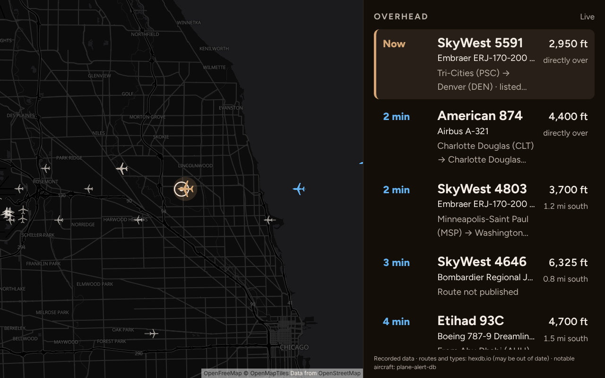
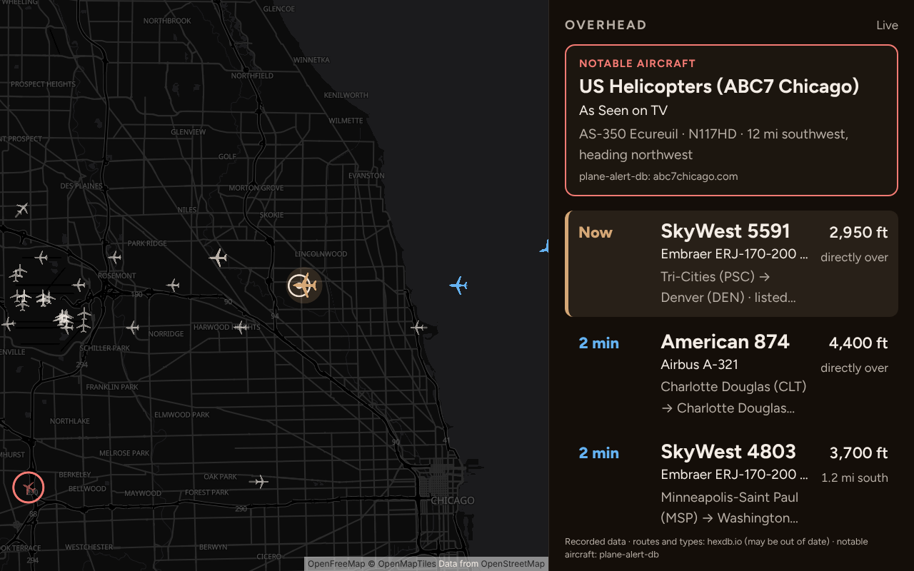
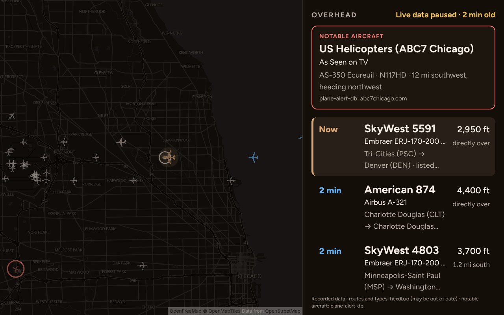
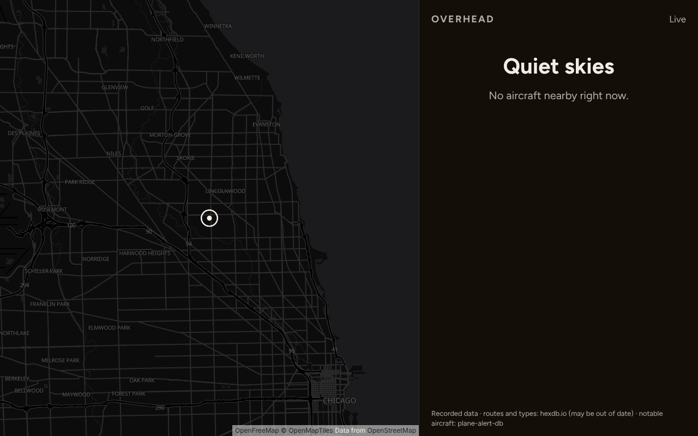
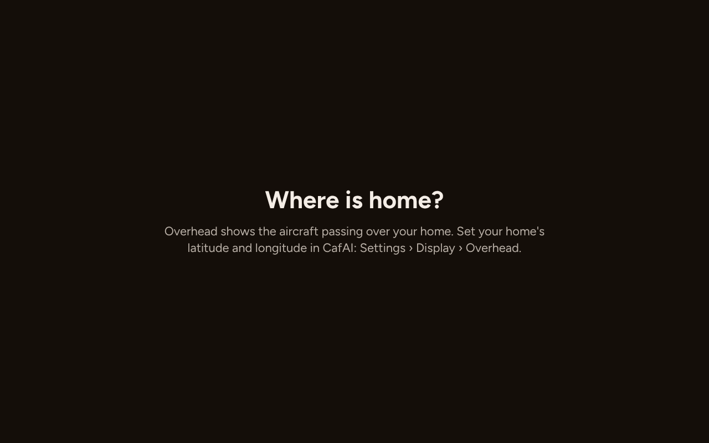

# Overhead: the plane-spotting screensaver

When CafAI has been idle for a few minutes and the machine is idle or
asleep, Overhead shows the aircraft passing over your home: a map on the
left, a departure board on the right ("Now", "In 3 min", "Just passed"),
and a card for any notable aircraft (a TV station's helicopter, a
government jet) from plane-alert-db. A tap closes it. No photos, no keys,
nothing posted anywhere.

| | |
|---|---|
| Live, with a plane overhead now |  |
| A notable aircraft in the area |  |
| Live data paused |  |
| Quiet skies |  |
| Setup needed |  |

The pictures are the mock build on recorded data (`npm run screenshots`).
Evidence for every external fact is in [DISCOVERY.md](DISCOVERY.md); every
departure from the brief, and every choice it left open, is in
[DECISIONS.md](DECISIONS.md).

## How it fits together

```
 airplanes.live ─┐
 adsb.fi ────────┼─► overhead.reaplugin (in Decaid) ──► GET /api/v1/plugins/overhead.reaplugin/overhead ──► CafAI (the skin)
 adsb.lol ───────┤      polls, tracks, looks up,            POST/GET .../config                              map + board
 hexdb.io ───────┤      matches notable aircraft             ws/v1/plugins/overhead.reaplugin/notable
 plane-alert-db ─┘
                                                                                     tiles.openfreemap.org ──► the map's tiles only
```

The skin talks to Decaid and nothing else, except the map's tile host. Every
third-party request is the plugin's (none of the providers sends CORS
headers, DISCOVERY section 4).

| Part | Where |
|---|---|
| The plugin (TypeScript, built into one `plugin.js`) | `src/overhead/plugin/`, `vite.plugin.config.ts` |
| What the plugin and the skin share: the payload, the settings table, readsb's shape | `src/overhead/shared/` |
| The pure logic: closest approach, buckets, direction, plain words, Turf geodesy | `src/overhead/domain/` |
| The screensaver, its map and board, its settings section | `src/overhead/ui/` |
| The one-line hook in the classic screensaver, the mount in the shell | `src/ui/saver/SaverOverlay.tsx`, `src/ui/shell/AppShell.tsx` |
| Recorded answers from every source | `fixtures/overhead/` |
| The mock build's plugin | `mock/overhead.ts` |

## Installing

1. `npm run build:plugin` (also part of `npm run build`) writes
   `dist-plugin/overhead.reaplugin/` and
   `dist-plugin/overhead.reaplugin-<version>.zip`.
2. In Decaid: Settings › Plugins › Install plugin › ZIP file, and pick the
   zip. On Decaid v0.9.2 the REST install routes need a management token
   (DISCOVERY section 2), so the native screen is the way.
3. In CafAI: Settings › Display › Overhead. Enter your home's latitude and
   longitude and Save. Overhead now takes the screensaver's place
   (DECISIONS O17).

## The plugin's endpoints

All under `http://<tablet>:8080/api/v1/plugins/overhead.reaplugin/`. Like
every plugin endpoint on Decaid they need no token and answer any origin.

| Endpoint | |
|---|---|
| `GET overhead` | The payload below. Each call counts as "the screensaver is showing" for 20 s, so the plugin polls every `PollIntervalSeconds`; `?active=0` reads without that. `?mock=1` answers the recorded replay. |
| `GET config` | `{ version: 1, values: { <ManifestKey>: value } }`: the settings in effect, defaults filled in. |
| `POST config` | Body `{ "values": { "HomeLat": 41.98, ... } }`. Saves the valid values over the stored ones (`null` clears one back to its default); answers like `GET`, plus `ignored`: the keys it could not use. |
| `ws/v1/plugins/overhead.reaplugin/notable` | One frame `{hex, operator, category, registration, type, distanceNm, at}` when a notable aircraft first comes within the notable area (DECISIONS O15). |

When it asks anyone: every `PollIntervalSeconds` (2 s at least) while the
skin asks for `overhead`; otherwise once a minute for the notable check,
except while the machine sleeps; never without a home; never in mock mode.
Each host hears from it at most once a second; `requests` in the payload
shows the count and the shortest gap for every host it has asked.

## The payload, version 1

Defined once, in `src/overhead/shared/payload.ts`, which the plugin builds
and the skin reads (`readPayload`, which keeps what it can read and drops
the rest). A change a version-1 reader cannot take raises `version`.

```ts
interface OverheadPayload {
  version: 1;
  generatedAt: number;            // ms since the epoch
  provider: 'airplanes.live' | 'adsb.fi' | 'adsb.lol' | 'mock' | null;
  dataAt: number | null;          // when the latest positions arrived
  stale: boolean;                 // none yet, or older than 30 s
  home: { lat: number; lon: number } | null;   // null: setup needed
  settings: OverheadSettings;     // every setting in effect (shared/settings.ts)
  aircraft: OverheadAircraft[];   // within the area, plus notable ones within the notable area
  notable: { hex: string; info: NotableInfo; since: number }[];
  providers: { id; state: 'ok' | 'resting' | 'unused'; until; lastStatus; lastError }[];
  requests?: { host: string; count: number; minGapMs: number | null }[];
}

interface OverheadAircraft {
  hex: string; callsign: string | null; registration: string | null;
  typeCode: string | null;        // "B39M"
  typeName: string | null;        // "Boeing 737 MAX 9"
  operator: string | null; airline: string | null;
  lat: number; lon: number; positionAt: number;
  altitudeFt: number | null; onGround: boolean;
  groundSpeedKt: number | null; trackDeg: number | null; verticalRateFpm: number | null;
  distanceNm: number; bearingDeg: number;      // from home
  cpa: { timeToCpaSeconds: number; distanceMiles: number; side: CompassPoint | null } | null;
  route: { raw: string; origin: RouteEnd; destination: RouteEnd; updatedAt: number | null } | null;
  notable: NotableInfo | null;    // plane-alert-db's row
  trail: [lon, lat][];            // up to 20, oldest first
}
```

The CPA is worked out at `positionAt`; the skin re-buckets it as time passes
(DECISIONS O10).

## Settings

The plugin's manifest declares them all (so Decaid's own Plugins screen
can edit them too); CafAI's Settings › Display › Overhead shows the same
table (`SETTING_SPECS`).

| Key | Default | |
|---|---|---|
| `ScreensaverOn` | true | Overhead takes the screensaver's place |
| `IdleMinutes` | 3 | untouched this long, machine idle or asleep |
| `HomeLat`, `HomeLon` | none | the screensaver asks for them until set |
| `HomeAirport` | KORD | arrivals and departures are told from it |
| `RadiusNm` | 25 | the map's area |
| `ListCeilingFt` | 10000 | the board lists aircraft at or below it |
| `PollIntervalSeconds` | 5 | never under 2 |
| `NotableRadiusNm` | 25 | |
| `NightDimStart`, `NightDimEnd`, `NightBrightness` | none, none, 10 | dims the screen through Decaid's display socket in those hours |
| `NowCpaMiles`, `NowWindowSeconds` | 0.5, 30 | "Now" |
| `SoonCpaMiles`, `SoonWithinMinutes` | 1.5, 10 | "In N min" |
| `PassedForSeconds` | 60 | "Just passed" |
| `MapTilerKey`, `MapTilerMapId` | none, dataviz-dark | optional; without a key the map is OpenFreeMap's |
| `MockMode` | false | replay the recorded fixtures |

## Mock mode

- In the plugin: `MockMode`, or `?mock=1` on `overhead`, replays
  `fixtures/overhead/adsbfi-point-ord.json` around your home, with hexdb's
  recorded answers and real plane-alert-db rows. It asks nobody.
- In CafAI's mock build: `?mockOverhead=<scenario>` runs the real plugin in
  the page (`live`, `notable`, `setup`, `stale`, `empty`, `loading`;
  `mock/overhead.ts`), and `?overheadPreview=1` opens it at once:
  `npm run dev:mock`, then
  `http://localhost:5173/?mockOverhead=notable&overheadPreview=1`.

## Out of scope (follow-ups)

- Aircraft photos (not wanted).
- Alexa or Echo.
- A log of what flew over the house, history or statistics. The plugin's
  tracker (`src/overhead/plugin/tracker.ts`) is where one would start; it
  stores nothing.
- Push notifications, sharing, posting anywhere. The `notable` socket is
  emitted for other surfaces to subscribe to later; nothing listens yet.
- Paid APIs (Flightradar24, FlightAware) and keys other than the optional
  MapTiler one.
- Any backend or proxy outside Decaid.
- Installing the plugin from CafAI itself: on Decaid v0.9.2 that needs a
  management token; on a Decaid whose extension protection is off, CafAI
  could `PUT /api/v1/plugins/overhead.reaplugin/source`.
- A MapTiler logo: MapTiler's free plan asks for it beside the text
  attribution Overhead shows (DISCOVERY section 8); with a MapTiler key,
  check it on your plan.
- airplanes.live's answer could not be seen from the development container
  (it refused it); its shape should be checked from a home connection, and
  the plugin already fails over if it differs (DECISIONS O2).
